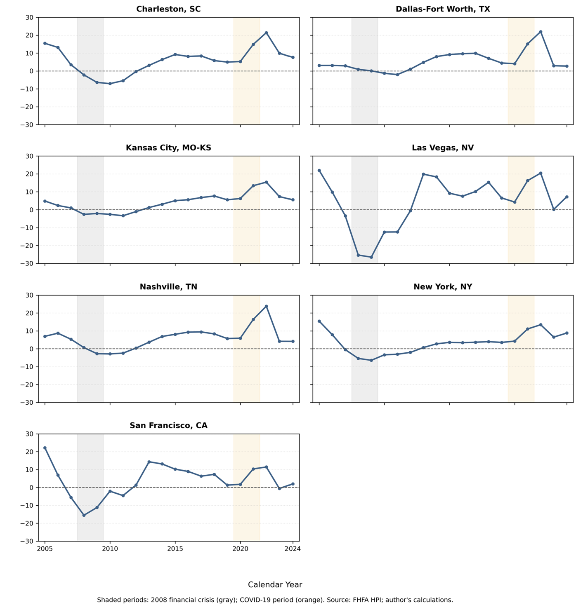
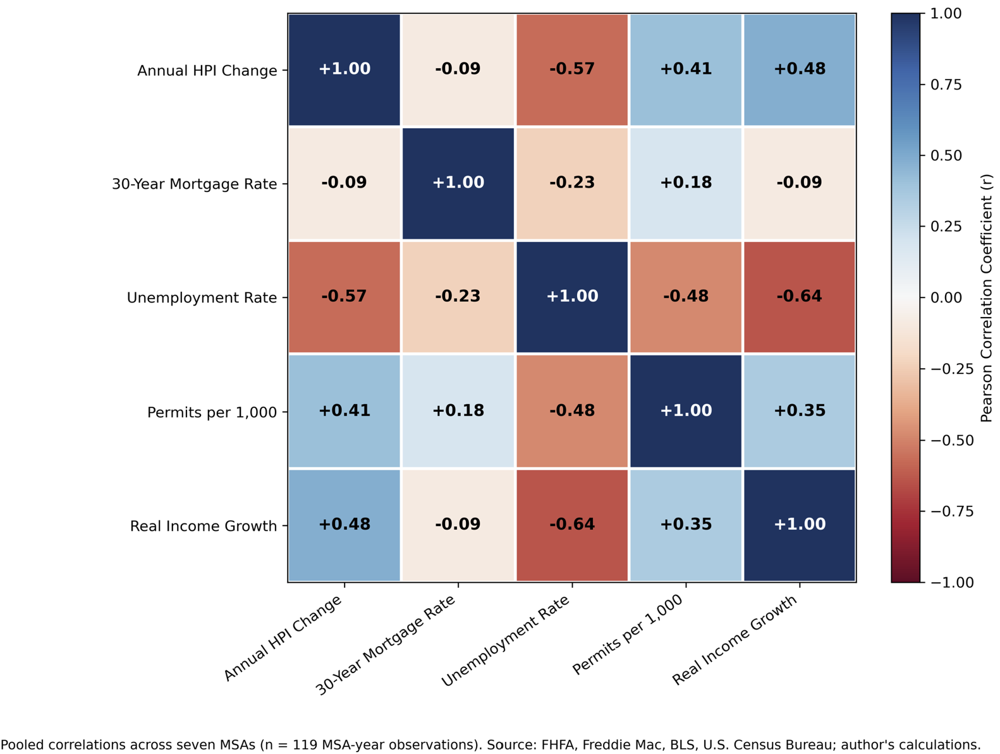
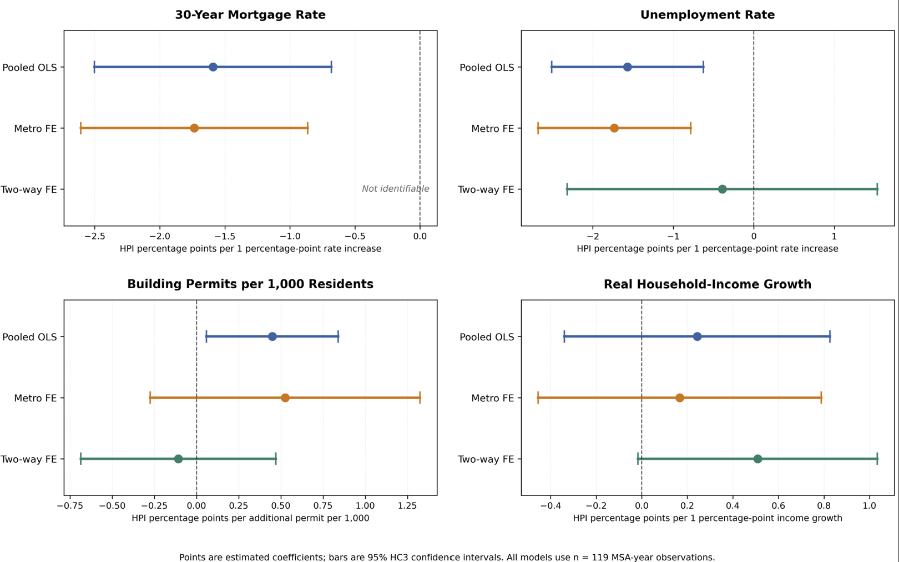

# Results — MIS581 Housing Market Analysis

These outputs are **extracted or transcribed from the submitted October 31, 2026 capstone paper**: *Economic, Financing, and Housing-Supply Factors Associated with Housing-Price Changes Across U.S. Metropolitan Areas*. The figures are the original embedded PNG images from the final paper; the CSV tables are transcriptions of its Tables 1 and 2, not new model runs.

## Figures

### Figure 1 — Metropolitan housing-price changes, 2005–2024

Annual FHFA HPI percent changes for the seven selected metropolitan areas, with financial-crisis and COVID-19 periods shaded for historical context.

### Figure 2 — Pearson correlation heatmap

Pooled Pearson correlations using **119 complete MSA-year observations**. The correlations are descriptive and do not adjust for metropolitan or calendar-year fixed effects.

### Figure 3 — Regression coefficient comparison

Coefficient estimates and 95% confidence intervals calculated using **HC3 heteroskedasticity-consistent standard errors** in the submitted analysis (n = 119 for each model). The national mortgage-rate coefficient is not separately identifiable under two-way fixed effects because year indicators absorb its variation.

## Tabular outputs

- [`table_1_primary_regression_comparison.csv`](table_1_primary_regression_comparison.csv): coefficients and HC3 p-values reported in **Table 1, page 23**. Models: pooled OLS, metropolitan fixed effects, and two-way fixed effects; 119 observations each. **Two-Way FE mortgage-rate fields are blank because the coefficient is not identifiable**, not because its p-value equals zero.
- [`table_2_permit_sensitivity.csv`](table_2_permit_sensitivity.csv): building-permit coefficients, HC3 p-values, and 95% intervals from **Table 2, page 29**. Reduced-predictor samples have n = 119 and n = 133.

### Summary of key findings

The complete descriptive MSA-year panel includes **140 observations** (seven metros by 20 years), and average annual HPI change is **4.70%**. The primary complete-case regression sample includes **119 observations**, excluding 2005, 2020, and 2021 due to missing or nonconsecutive real-income-growth data. The three-predictor sensitivity model includes **133 observations** (2020 still excluded due to missing ACS population data). In the primary pooled and metropolitan fixed-effects models, national mortgage rates and unemployment have statistically significant negative associations with HPI changes. In the two-way fixed-effects model, unemployment, building permits, and real-income growth do **not** meet the .05 threshold; national mortgage rates are not separately identifiable. The building-permit result in metropolitan fixed effects changes significance between the 119- and 133-observation reduced-predictor samples.

## Interpretation and provenance

- The study is **observational**: estimates are associations, **not causal effects or housing-price forecasts**.
- Seven selected metropolitan areas limit generalizability. Within-metro serial dependence and only seven metropolitan clusters limit inferential certainty; HC3 alone does not address serial correlation.
- The 2020 ACS one-year release is unavailable in the study series. Values are left missing rather than imputed.
- The PNGs are extracted unchanged from the DOCX; the CSV tables are **human-readable transcriptions** of the paper, not regenerated computational output. Small display rounding is inherited from the paper.
- Primary paper: *MIS581_WK7_CT_Final_Paper*, submitted October 31, 2026. Figures on pages **18, 20, 24**; model tables on pages **23, 29**.
